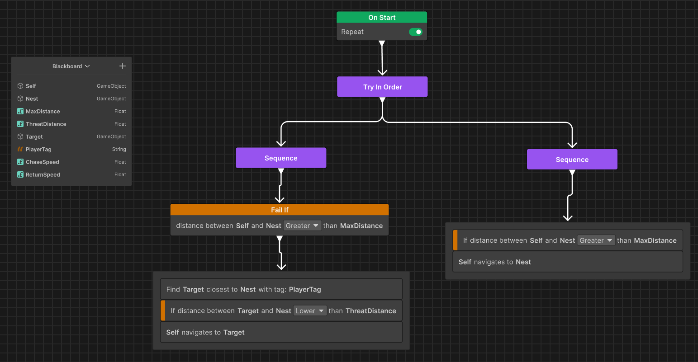

# COLLECTIVE MOVEMENT & BEHAVIOUR TREES

## Guard Patrol (Formation Motion)
Replacing the single guard from the previous delivery with a coordinated patrol requires keeping the original leader untouched. Follower's functionality is moved to C# scripts. To achieve this, this logic is split into `FormationManager` (slot calculation and state synchronization) and `FormationFollower` (individual navigation and alignment).

### Slot Assignment & Grid Layout (`FormationManager.cs`)
```csharp
public void AssignSlots(bool Teleport)
{
    int l_FollowersQty=m_Followers.Count;
    for (int i=0; i < l_FollowersQty; ++i)
    {
        ComputeSlot(i, out Vector3 l_Offset, out float l_Yaw);
        m_Followers[i].SetSlot(m_Leader, m_LeaderNavMeshAgent, l_Offset, l_Yaw, Teleport);
        m_Followers[i].GetComponent<NavMeshAgent>().avoidancePriority=Mathf.Clamp(51 + i, 0, 99);
    }
}

public void ComputeSlot(int i, out Vector3 Offset, out float Yaw)
{
    Yaw=0f;
    int l_Row=i / m_Columns;
    int l_Col=i % m_Columns;
    float l_X=(l_Col - (m_Columns - 1) * 0.5f) * m_SpaceBetweenUnits;
    Offset=new Vector3(l_X, 0f, -(l_Row + 1) * m_SpaceBetweenUnits);
}
```
`FormationManager` reads the leader's `NavMeshAgent` and `Animator` directly to comunicate its `Running` state. Assigning an `avoidancePriority` (starting at 51) is a key to prevent followers from deadlocking or pushing each other when navigating narrow corridors. As it can be seen in the demonstration it's very important when fleeing or reorganizating the followers formation.

### NavMesh Validation & Catch-Up (`FormationFollower.cs`)
```csharp
void GoToSlot()
{
    Vector3 l_Target=SlotPosition();

    if (!NavMesh.SamplePosition(l_Target, out NavMeshHit hit, m_SampleRadius, NavMesh.AllAreas))
        return;
    m_NavMeshAgent.destination=hit.position;

    float l_Reference=m_SpeedSource != null ? m_SpeedSource.speed : m_BaseSpeed;
    float l_Distance=Vector3.Distance(transform.position, hit.position);
    m_NavMeshAgent.speed=l_Distance > m_CatchUpDistance ? l_Reference * m_CatchUpSpeedMultiplier : l_Reference;
}
```
Updating destinations at a fixed interval (`m_UpdateFreq`) instead of every frame makes fofllower's pathfinding feels more natural. Sampling the target with `NavMesh.SamplePosition` ensures followers never try to walk into walls when the leader turns near an obstacle, while the catch-up speed multiplier keeps the formation cohesive during sprints and sharp corners.

## Dynamic Formation Switching (PAC Ampliation)
As an extension to the base patrol, I implemented `FormationManagerMulti` so the squad adapts dynamically when the leader is running (can be changed if in a future it's needed to separate running and threat logic), switching from the standard `Patrol` grid to a `DefensiveCircle` surrounding the leader and facing outwards.

### Circle Calculation & Transition Safeguards (`FormationManagerMulti.cs`)
```csharp
if(m_CurrentFormation==FormationType.DefensiveCircle)
{
    int l_Count=Mathf.Max(1, m_Followers.Count);
    float l_Radius=Mathf.Max(m_MinCircleRadius, l_Count*m_SpaceBetweenUnits/(2f*Mathf.PI));
    float l_Angle=i*2f*Mathf.PI/l_Count;
    Offset=new Vector3(Mathf.Sin(l_Angle), 0f, Mathf.Cos(l_Angle))*l_Radius;
    Yaw=l_Angle*Mathf.Rad2Deg;
    return;
}
```
```csharp
void UpdateFormation(bool Threatened)
{
    m_FormationTimer+=Time.deltaTime;
    FormationType l_Desired=Threatened ? FormationType.DefensiveCircle : FormationType.Patrol;

    if(l_Desired==m_CurrentFormation)
    {
        m_PendingTimer=0f;
        return;
    }

    m_PendingTimer+=Time.deltaTime;
    if(m_PendingTimer>=m_SwitchDelay && m_FormationTimer>=m_MinTimeInFormation)
        ChangeFormation(l_Desired);
}
```
To avoid flickering if a threat appears and disappears rapidly, I added `m_SwitchDelay` and `m_MinTimeInFormation` to feel the transitions smoother and more natural. Additionally, when switching formations, `ReorderFollowersByProximity()` assigns closest slot for each follower to minimize total travel distance, preventing crossing paths and colliding between units when forming the circle.

## Fairy Cauldron (Flocking)
To simulate a swarm of fairies spawning from the cauldron, `FlockManager` is attached to it and instantiate the fairies inside a bounded space around it. Each fairy have a `NavMesh Obstacle` component so the patrolling guards react to and avoid colliding the swarm.

### Spawning & Dynamic Goal (`FlockManager.cs`)
```csharp
IEnumerator ChangeGoal()
{
    while (true)
    {
        yield return new WaitForSeconds(Random.Range(m_GoalMinTime, m_GoalMaxTime));

        if (m_Leader==null)
        {
            m_GoalPosition=transform.position + Random.insideUnitSphere*m_SwarmRadius*0.5f;
            m_GoalPosition.y=Mathf.Max(m_GoalPosition.y, m_MinHeight + 0.5f);
        }
    }
}
```
As the task 2 asked specifically to not having an insect leader (fairy in our case), when no leader is active, shifting `m_GoalPosition` periodically inside half the swarm radius prevents the fairies from orbiting a rigid static point. This makes the swarm drift organically above the cauldron, while clamping `y` to `m_MinHeight + 0.5f` keeps them from clipping into the ground.

### Flocking Rules (`Flock.cs`)
```csharp
if (l_Num > 0)
{
    l_Align/=l_Num;
    m_Speed=Mathf.Clamp(l_Align.magnitude, m_FlockManager.m_MinSpeed, m_FlockManager.m_MaxSpeed);
    l_Cohesion=(l_Cohesion / l_Num - transform.position).normalized*m_Speed;

    l_Steer=l_Cohesion + l_Align + l_Separation*m_FlockManager.m_SeparationWeight;
}
```

## Fairy Leader (Behaviour Tree)
To give the fairies world interaction, a leader fairy is controlled with Behaviour Trees. The tree checks whether the leader guard approaches the cauldron: if it enters the detection range, the leader chases them away; once the leader moves far enough from the cauldron, the leader returns it.




### Following the Leader (`Flock.cs`)
```csharp
if (m_FlockManager.m_Leader != null)
{
    Vector3 l_ToLeader=m_FlockManager.m_Leader.position - transform.position;
    Vector3 l_Follow=l_ToLeader.normalized*m_Speed*m_FlockManager.m_LeaderWeight;
    if (l_ToLeader.magnitude < m_FlockManager.m_LeaderSeparation)
        l_Follow=-l_Follow;
    l_Steer += l_Follow;
}
```
On the C# side, `FlockManager.m_Center` automatically switches to `m_Leader.position` whenever a leader is assigned. Adding a weighted follow vector that inverts when closer than `m_LeaderSeparation` ensures the fairies trail and surround the leader cleanly instead of collapsing onto a single point.

<div align="center">
	<a href="https://youtu.be/jFBGHBYS4IE"></a>
	<p align="center"><a href="https://youtu.be/jFBGHBYS4IE">Watch demo video on YouTube</a></p>
</div>

## Generative AI
I used generative AI to solve some problems. For example:
<br>
<b> Prompt: </b>
hazme un resumen de los nodos de comportamiento en behaviour de unity 6.3 y explicame que función tiene cada uno comparandose con la teoria generica de behaviour trees

<b> Result: </b>
En **Unity 6.3**, el sistema oficial de árboles de comportamiento se gestiona mediante el paquete **Unity Behavior** (`com.unity.behavior`). Aunque sigue los fundamentos clásicos de la teoría de *Behavior Trees* (BT), Unity renombra varios conceptos tradicionales para hacerlos más legibles en lenguaje natural e introduce un modelo híbrido dirigido por eventos (*event-driven*) y nodos de unión (*Join*) que lo acercan ligeramente a un grafo de flujo.

---

### 1. Tabla Comparativa: Unity Behavior vs. Teoría Genérica de BT

| Categoría Teórica (BT Clásico) | Nombre en Unity Behavior | Función Principal |
| --- | --- | --- |
| **Root (Raíz)** | **On Start** / **Event Nodes** | Punto de entrada del grafo. En Unity puede reiniciarse en bucle o dispararse mediante eventos. |
| **Sequence (Secuencia / AND)** | **Sequence** | Ejecuta hijos en orden; falla si uno falla y triunfa si todos triunfan. |
| **Selector / Fallback (OR)** | **Try In Order** | Ejecuta hijos en orden hasta que **uno** tenga éxito; solo falla si todos fallan. |
| **Parallel (Paralelo)** | **Run In Parallel** | Ejecuta todas las ramas hijas simultáneamente según una política de éxito/fallo configurada. |
| **Random Selector / Sequence** | **Random** | Elige y ejecuta una rama hija al azar. |
| **Decorator (Decorador)** | **Modifier Nodes** | Nodos con un solo hijo que alteran su ejecución o modifican el estado que devuelve. |
| **Observer / Conditional Abort** | **Abort** / **Restart** / **Conditional Guard** | Interrumpen o reinician ramas activas de forma reactiva cuando cambia una condición del Blackboard. |
| **Leaf / Task (Hoja / Tarea)** | **Action Nodes** | Ejecutan la lógica final (moverse, animar, esperar, modificar variables). |
| *Sin equivalente estricto en BT* | **Join Nodes** (*Wait For All / Any*) | Permiten volver a unir múltiples ramas paralelas en un único flujo hijo. |

---

### 2. Desglose Detallado de los Nodos en Unity 6.3

Unity divide sus nodos en cuatro familias arquitectónicas principales: **Sequencing (Composición)**, **Modifiers (Decoradores)**, **Join (Unión)** y **Actions (Tareas)**, además de los **Events (Raíces)**.

#### A. Nodos de Secuenciación (*Sequencing / Composite Nodes*)

Equivalen a los **nodos compuestos** de la teoría clásica: tienen múltiples hijos y deciden en qué orden evaluarlos.

* **Sequence:** Igual que en la teoría estándar, ejecuta sus ramas de izquierda a derecha (o de arriba abajo). Si un hijo devuelve `Failed`, detiene la ejecución y devuelve `Failed`. Solo devuelve `Succeeded` si todos completan con éxito. *Nota de Unity:* Puedes apilar nodos de acción verticalmente en el editor para crear una `Sequence` implícita sin necesidad de dibujar cables.
* **Try In Order:** Es el clásico **Selector** (o *Fallback*). Prueba opciones por orden de prioridad hasta que una devuelve `Succeeded`, momento en el que deja de evaluar las demás y devuelve éxito.
* **Run In Parallel:** Ejecuta todas sus ramas a la vez. Permite configurar políticas (equivalentes a las políticas *Require One* / *Require All* de la teoría) para decidir si el nodo termina cuando acaba la primera rama o cuando terminan todas.
* **Random:** Selecciona una única rama hija de forma aleatoria. En teoría genérica corresponde a un *Random Selector*.
* **Conditional Branch / Switch / Switch Flag:** Bifurcan el flujo según un booleano o un `Enum` (incluyendo máscaras de bits con `Switch Flag`). Aunque en BT puro esto se hace combinando un *Selector* con condiciones en cada rama, Unity ofrece estos nodos directos para evitar árboles excesivamente profundos.

#### B. Nodos Modificadores (*Modifier Nodes*)

Corresponden exactamente a los **Decoradores (Decorators)** de la teoría de BT: envuelven a un **único** nodo hijo para alterar su comportamiento o transformar el estado que retorna.

* **Inverter:** Invierte el resultado del hijo (`Succeeded` $\$rightarrow `Failed` y viceversa), igual que el decorador *Inverter* / *Negate* clásico.
* **Succeeder:** Fuerza a que la rama devuelva `Succeeded` aunque el hijo falle. Muy útil dentro de una `Sequence` para pasos opcionales que no deben abortar toda la cadena.
* **Repeat:** Vuelve a ejecutar su nodo hijo según un modo configurado (un número fijo de veces, infinitamente, o hasta que falle/triunfe). Equivale al decorador *Repeater* / *Until Fail*.
* **Cooldown:** Impone un tiempo mínimo de espera antes de permitir que su rama vuelva a ejecutarse, idéntico al decorador *Cooldown* estándar.
* **Time Out:** Corta la ejecución de su hijo y devuelve fallo si tarda más de los segundos especificados en completarse (decorador *Time Limit*).
* **Abort y Restart (Observadores):** Mientras la teoría clásica requiere reevaluar el árbol desde la raíz cada *tick* para reaccionar a cambios, Unity implementa un modelo reactivo (similar a los *Observer Aborts* de Unreal Engine). Estos nodos vigilan condiciones del Blackboard: **Abort** cancela la rama en curso si se cumple la condición, mientras que **Restart** la detiene y la vuelve a lanzar desde el principio.

#### C. Nodos de Acción (*Action Nodes*)

Equivalen a los **nodos hoja (*Leaf / Task Nodes*)**: no tienen hijos y ejecutan trabajo real en el motor. Pueden devolver `Running`, `Succeeded` o `Failed`.

* **Conditional Guard:** Evalúa una condición del Blackboard y devuelve `Succeeded` o `Failed` al instante. Es el equivalente directo a un nodo hoja de tipo **Condition** en la teoría genérica.
* **Delay (*Wait / Wait Range*):** Mantiene el estado `Running` durante un tiempo fijo o aleatorio y luego devuelve `Succeeded`.
* **Movimiento y Navegación:** Nodos integrados con `NavMeshAgent` (como *Navigate to Target* o *Patrol*) para desplazar agentes por la escena.
* **Animación y GameObjects:** Permiten disparar parámetros en el `Animator` (*Set Animator Trigger/Bool/Float*), activar/desactivar objetos o reproducir audio.
* **Blackboard y Debug:** Nodos para leer/escribir variables compartidas (*Set Variable Value*) o imprimir mensajes en consola (*Log Message*).
* **Subgraphs:** Permiten encapsular otro *Behavior Graph* dentro de un nodo para reutilizar comportamientos modulares (por ejemplo, un subárbol de "Combate" dentro de un árbol general de "Guardia").

#### D. Nodos de Unión (*Join Nodes*) — *Diferencia clave con la teoría*

En un *Behavior Tree* estricto, la estructura es un árbol acíclico donde cada nodo tiene **un solo padre**. Unity rompe esta restricción permitiendo que múltiples ramas paralelas converjan de nuevo mediante dos nodos:

* **Wait For All:** Tiene múltiples entradas y una salida; espera a que **todas** las ramas padre conectadas finalicen antes de ejecutar su nodo hijo.
* **Wait For Any:** Ejecuta su nodo hijo en cuanto **cualquiera** de las ramas padre conectadas termina.

#### E. Nodos de Evento (*Event Nodes*)

En la teoría clásica existe un único nodo raíz (*Root*) que recibe pulsos (*ticks*) constantemente. En Unity 6.3, además del nodo raíz estándar (**On Start**, que puede configurarse para repetirse en bucle), existen **Event Nodes** que actúan como raíces secundarias basadas en mensajes, permitiendo que el agente reaccione a eventos externos del juego sin evaluar continuamente ramas innecesarias.

---

### 3. Diferencias Clave de Estados

Mientras que la teoría genérica define 3 estados básicos (`Running`, `Success`, `Failure`), Unity Behavior amplía los estados internos a **6** para gestionar la asincronía y las interrupciones:

1. **Uninitialized:** El nodo aún no ha sido alcanzado en la ejecución actual.
2. **Running:** El nodo está ejecutando su lógica activa.
3. **Waiting:** Específico de nodos padre/unión que están pausados esperando a que terminen sus hijos o ramas previas.
4. **Succeeded:** Completado con éxito.
5. **Failed:** Falló en su ejecución o condición.
6. **Interrupted:** El nodo estaba en ejecución pero fue detenido externamente por un nodo *Abort* o *Restart*.

Para ver en funcionamiento práctico los nodos principales de control de flujo (*Sequence*, *Try In Order*, *Run In Parallel* y *Random*), consulta el tutorial oficial [Control Flow Nodes in Unity Behavior](https://www.youtube.com/watch?v=UINw_7wHNSc). Este vídeo demuestra paso a paso cómo se comporta cada nodo de secuenciación dentro del editor visual de Unity.